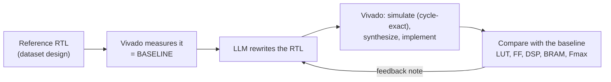
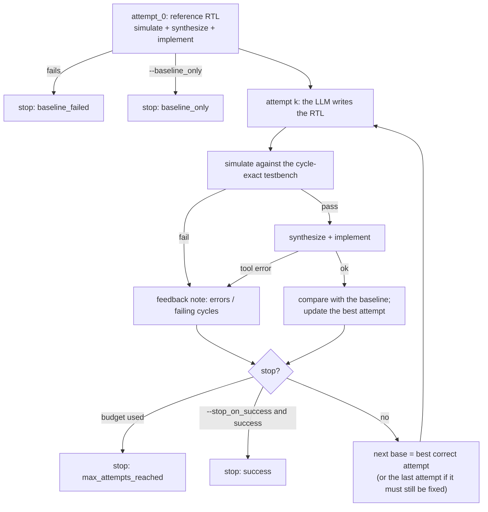

# FPGA-RTL-Transform

**An LLM rewrites a working Verilog design so that it uses fewer FPGA resources or runs faster, at exactly the same
latency. Vivado checks every attempt and tells the LLM what happened.**

The benchmark has seven complete accelerators (systolic arrays, a FIR filter, a 3x3 convolution, a dot-product
engine). Target: AMD/Xilinx 7-Series (default part `xc7a100tcsg324-1`), Vivado 2024.1.

## Contents

1. [How it works](#1-how-it-works)
2. [Requirements](#2-requirements)
3. [Quick start](#3-quick-start)
4. [The two experiment switches](#4-the-two-experiment-switches)
5. [The dataset](#5-the-dataset)
6. [The loop, the metrics and the judging rule](#6-the-loop-the-metrics-and-the-judging-rule)
7. [What the LLM receives and returns](#7-what-the-llm-receives-and-returns)
8. [Command reference](#8-command-reference)
9. [Output layout](#9-output-layout)
10. [Advanced analysis](#10-advanced-analysis)
11. [Folder map](#11-folder-map)
12. [Extending](#12-extending)
13. [Troubleshooting](#13-troubleshooting)

## 1. How it works



- **The task.** The LLM gets the reference RTL, the interface and timing contract, the clock constraint and the
  measured baseline. It answers with a complete new design and the list of edits it made.
- **The rule.** The module name, the ports and the timing (`done` / valid flags and the data on exactly the same
  clock edges) never change. Inside, anything goes.
- **Success.** The design simulates correctly, passes synthesis and implementation, and is **better than the baseline
  in at least one** of LUT, FF, DSP, BRAM, Fmax. Getting worse in another metric is allowed and reported.
- **The loop.** After each attempt the LLM receives a feedback note (how rich it is depends on `--feedback_detail`)
  and tries again, up to `--max_attempts` times.
- **Research use.** Two switches (what the LLM is told, what feedback it gets) define an experiment; each setting has
  its own output folder, so configurations can be compared ([section 10](#10-advanced-analysis)).

## 2. Requirements

- Vivado 2024.1 (xsim, synthesis, implementation) and its `vivado` binary in `VIVADO_PATH`.
- The Python environment of `LaMDA-FPGA` (`source activate.sh` in `LaMDA/LaMDA-FPGA`).
- An API key for one LLM provider (`OPENAI_API_KEY`, `GEMINI_API_KEY`, `ANTHROPIC_API_KEY`, `OPENROUTER_API_KEY` or
  `ELM_API_KEY`), exported or stored in a `.env` file as described in the `LaMDA-FPGA` README.
- Baseline measurement and design checks need Vivado only. They need no API key.

`make check_env` (from the `LaMDA-FPGA` Makefile, also available here) shows which variables are set.

## 3. Quick start

Run everything from this folder (`LaMDA/LaMDA-FPGA/Evaluation/FPGA-RTL-Transform`).

```bash
export VIVADO_PATH=/opt/Xilinx/Vivado/2024.1/bin/vivado

make help                              # every target and variable, with defaults and valid values
make check_designs CHECK_ARGS=1        # simulate the reference of design 1 against its testbench (Vivado)
make measure_baselines DESIGN_IDS=1    # Vivado numbers of the reference RTL (no LLM)

# one LLM run: design 1, no primers, report digests as feedback, at most 3 attempts, stop at the first success
make LLM_PROVIDER=openai MODEL=gpt-4o DESIGN_ID=1 KNOWLEDGE=none FEEDBACK_DETAIL=reports \
     MAX_ATTEMPTS=3 STOP_ON_SUCCESS=true run_rtl_transform
```

The result is `Outputs/<knowledge>/<feedback_detail>/design_<id>_<module>/run_<timestamp>_<pid>/fabric_report.json`
(see [section 9](#9-output-layout)). Runs never overwrite each other. The exit status is 0 for a `PASS`, 1 otherwise.

The same run without `make`, from `LaMDA/LaMDA-FPGA`:

```bash
python3 -B Evaluation/FPGA-RTL-Transform/Run.py --design_id 1 --model gpt-4o --provider openai \
        --knowledge none --feedback_detail reports --max_attempts 3 --stop_on_success --verbose
```

## 4. The two experiment switches

| Switch | Values | What it changes |
|--------|--------|-----------------|
| `--knowledge` (`KNOWLEDGE=`) | `none`, `primers` (default), `primers+patterns` | What the LLM is told about the FPGA fabric. `none`: nothing beyond what it already knows. `primers`: three short resource notes (LUT, DSP48E1, block RAM) are added to the system prompt. `primers+patterns`: also generic RTL transformation patterns and a guide to reading the Vivado results. |
| `--feedback_detail` (`FEEDBACK_DETAIL=`) | `none`, `metrics`, `reports` (default), `reports+logs`, `reports+logs+edits` | The evidence the LLM gets after an attempt. The levels are cumulative, see below. |

The `primers+patterns` level is a strict superset of `primers`, so the two measure what the patterns are worth.

**Feedback levels.** Each level adds exactly one kind of evidence to the previous one, so two neighbouring levels
differ by one factor only.

| Level | Adds | Where it appears |
|-------|------|------------------|
| `none` | nothing: only the verdict ("better in LUT, BRAM, worse in FF") | result note |
| `metrics` | LUT, FF, DSP, BRAM, Fmax against the baseline, the timing basis, the primitive histogram | first prompt (baseline), result note, history table |
| `reports` | a digest of the Vivado reports: area per module, memories, DSP mapping, control sets, worst path | first prompt, result note (compared with the best attempt so far) |
| `reports+logs` | what the tools did, mined from the logs: `opt_design` changes, `phys_opt` replications, the WNS trajectory of place and route, log messages with the RTL line | first prompt (reference), result note (this attempt) |
| `reports+logs+edits` | the record of the earlier edits: per attempt the declared transformation labels, whether the reports support each one, and the metric change against the attempt it started from | after the history table |

With `--stop_stage synth` the evidence at every level comes from the synthesis reports and log only, and the metrics
carry an "estimated timing" flag. A run stopped at synthesis never shows placement or routing evidence.

Typical combinations:

| `KNOWLEDGE` | `FEEDBACK_DETAIL` | Question it answers |
|-------------|-------------------|---------------------|
| `none` | `metrics` | What does the LLM do on its own, with numbers only? (least information) |
| `primers` | `metrics` | Does resource knowledge help when the feedback is only numbers? |
| `none` | `reports` | Do the report digests help without primers? |
| `primers` | `reports` | Everything on (default). |
| `primers+patterns` | `reports+logs+edits` | The richest configuration. |

## 5. The dataset

Seven complete accelerators in four families, in `Dataset/fabric_opt_problems.json` (generated from `Dataset/src/`).
Each is a small hierarchy of Verilog modules, correct but written plainly, with a self-checking cycle-exact testbench
and a clock constraint. The LLM gets one design per run.

| ID | Module | Family | What it does | Clock |
|----|--------|--------|--------------|-------|
| 1 | `sa_os_4x4` | output-stationary systolic array | `C(4x256) = A(4x256) x B(256x4)`, INT8 in, 32-bit out | 5.0 ns |
| 2 | `sa_ws_4x4` | weight-stationary systolic array | `C(256x4) = A(256x4) x W(4x4)` | 5.0 ns |
| 3 | `sa_is_4x4` | input-stationary systolic array | `C(4x256) = A(4x4) x B(4x256)` | 5.0 ns |
| 4 | `fir16` | streaming FIR filter | symmetric 16-tap FIR on an INT8 stream, 24-bit result | 4.0 ns |
| 5 | `conv3x3` | streaming convolution | 3x3 convolution of a 64-pixel-wide stream with a line buffer, 20-bit result | 4.0 ns |
| 6 | `sat_dot32` | dot-product engine | rounding, saturating dot product of two 32-element INT8 vectors | 4.0 ns |
| 7 | `sa_os_8x8` | scaled systolic array | design 1 scaled to 8x8 (64 PEs) | 5.0 ns |

All clocks are constrained with `create_clock -period <P> -name clk [get_ports clk]`, with no I/O delays, so only
register-to-register paths are timed.

**Latency contracts** (clock edges are counted with the edge that samples the input as edge 1):

| ID | Contract |
|----|----------|
| 1, 2, 3, 7 | `done` is high 265 / 269 / 269 / 273 edges after the edge that samples `start`. `c_data` shows the result one edge after `c_addr`. `start` while busy is ignored. |
| 4 | A sample accepted at edge t gives `y_valid = 1` and the result right after edge t+5; `y_data` is compared only while `y_valid` is 1. |
| 5 | A pixel accepted at edge t that completes a window gives `out_valid = 1` and the result right after edge t+4. |
| 6 | `done` is high right after the 36th edge of a run; `start` while busy is ignored; `result` is compared only while `done` is high. |

The exact text of each design (word packing, run protocol, read-out, what must not change) is the `Problem` field of its
dataset entry and the top-module header is the `Module header` field; the LLM receives both.

**Measured baselines** (post-implementation, reference RTL, `xc7a100tcsg324-1`, Vivado 2024.1). Fmax is
$1000 / (T - \mathrm{WNS})$ with the clock period $T$.

| ID | LUT | FF | DSP | BRAM | WNS (ns) | Fmax (MHz) |
|----|-----|----|-----|------|----------|------------|
| 1 `sa_os_4x4` | 2169 | 1182 | 0 | 0 | -0.586 | 179.0 |
| 2 `sa_ws_4x4` | 1600 | 650 | 0 | 2 | -1.922 | 144.5 |
| 3 `sa_is_4x4` | 1584 | 699 | 0 | 2 | -1.932 | 144.3 |
| 4 `fir16` | 553 | 598 | 0 | 0 | -0.489 | 222.8 |
| 5 `conv3x3` | 259 | 307 | 0 | 0 | -0.048 | 247.0 |
| 6 `sat_dot32` | 144 | 78 | 0 | 0 | -1.555 | 180.0 |
| 7 `sa_os_8x8` | 7688 | 4448 | 0 | 0 | -0.989 | 167.0 |

All designs miss their clock because the multiply-add is built from LUTs and carry chains, so there is room to gain in
area and in timing. Place and route varies a little between runs; the 0.05 ns tolerance of the Fmax comparison absorbs
that. Every LLM run measures the baseline again, so run and baseline always use the same tools and settings.

**What a dataset entry contains.**

| Field | Content | Shown to the LLM? |
|-------|---------|-------------------|
| `ID`, `module`, `dataflow`, `family`, `tags` | identification | the module name |
| `Problem` | the task text | yes |
| `Module header` | the exact top-module header | yes |
| `reference_rtl` | the reference Verilog, all modules | yes |
| `Testbench` | the cycle-exact testbench with an untouched copy of the reference (`ref_*` modules) | no (it is run, not shown) |
| `Clock Constraint` | the XDC text | yes |
| `latency_contract` | one sentence: when the outputs are valid | yes |
| `baseline_metrics`, `measurement` | the measured baseline and when it was measured | the run measures it again and sends those numbers |
| `known_inefficiency`, `levers` | annotations: what could be improved, and which transformation tags could help | **never** |

The annotations let readers of the results ask "did the LLM find the DSP48E1 opportunity?" by comparing the `levers`
of a design with the labels declared in the run. The prompt builder does not use them.

**The testbench.** Each `tb.v` instantiates the design under test (`uut`) and an untouched copy of the reference
(`refm`), applies the same stimulus (three runs: random data, all operands -128, random again; resets between runs;
`start` also pulsed while busy) and compares the outputs in every clock cycle. It also checks the reference against a
software model, so a wrong reference cannot pass silently. Failures print as
`cycle=412 | done=1 (expected 0) | FAIL` (up to 20 lines); these lines are part of the feedback after a failed
simulation. `make check_designs` additionally builds **mutants** of the reference (`done` one cycle late or early, a
wrong coefficient, an off-by-one window start, ...) and requires the testbench to catch every one.

## 6. The loop, the metrics and the judging rule



| Rule | Value |
|------|-------|
| Attempt budget | `--max_attempts` (default 6); `attempt_0`, the reference, does not count |
| Early exit | off by default; `--stop_on_success` stops at the first success |
| Best so far | the correct attempt with the most `better` metrics, then the fewest `worse`; on a tie the earlier one stays |
| Base of the next attempt | the best attempt if the last one was correct, otherwise the last attempt (to be fixed) |
| A Vivado stage that stops without an error line | repeated once before the attempt is called a failure |

The baseline uses exactly the same flow as the attempts, so a difference is a property of the design, not of the tools.

**Metrics** (collected after the last Vivado stage that ran: post-implementation for `--stop_stage impl`,
post-synthesis for `synth`; the prompt states which one).

| Key | Meaning |
|-----|---------|
| `LUT_USED` | LUTs (logic, memory and shift register) |
| `FF_TOTAL` | flip-flops (registers and latches) |
| `DSP48E1` | DSP slices |
| `BRAM` | block RAM in RAMB36 equivalents (a RAMB18 counts 0.5) |
| `wns_ns` | worst slack of the clocked register-to-register paths, `None` if there is none |
| `fmax_mhz` | $1000 / (T - \mathrm{WNS})$; with no timed path, the primitive limit from the pulse-width report |
| `logic_levels`, `data_path_delay_ns` | the worst path |

Power is not measured. There is no score and no weighting: for each metric the only question is whether the attempt
is **better**, the **same** or **worse** than the baseline.

**Judging rule.**

| Metric | `better` when | `same` when | Not compared when |
|--------|---------------|-------------|-------------------|
| LUT, FF, DSP, BRAM | fewer | equal | never |
| Fmax | $\mathrm{WNS}_\text{attempt} - \mathrm{WNS}_\text{baseline} > 0.05$ ns | within $\pm 0.05$ ns | either side has no WNS |

DSP and BRAM count like LUT: **using** a DSP48E1 where the baseline has none is `worse` in DSP. If no constrained
register-to-register path is left (everything absorbed into DSP48E1 or block RAM) there is no WNS and the attempt must
win on area.

**Outcome of one attempt.**

| `outcome` | Meaning | Success? |
|-----------|---------|----------|
| `functional_fail` | no Verilog, compile error, or the testbench failed | no |
| `tool_fail` | the simulation passed but synthesis or implementation failed | no |
| `improved` | at least one metric `better`, none `worse` | yes |
| `mixed` | at least one `better` and at least one `worse` | yes |
| `regression` | none `better`, at least one `worse` | no |
| `no_gain` | all compared metrics `same` | no |

**Final verdict.** `final_verdict` is `PASS` if and only if the best attempt is a success, otherwise `FAIL`. Special
values: `BASELINE_FAILED` (the reference did not pass the flow) and `BASELINE_ONLY` (`--baseline_only`).

| `stop_reason` | Meaning |
|---------------|---------|
| `success` | `--stop_on_success` and an attempt succeeded |
| `max_attempts_reached` | the budget was used up (verdict `PASS` or `FAIL` depending on the best attempt) |
| `baseline_failed` | the reference did not pass simulation, synthesis or implementation |
| `baseline_only` | only `attempt_0` was measured |
| `error` | an exception in the pipeline |

**Latency.** The testbench compares the outputs with the reference in every cycle, so latency is identical to the
reference. There is no tolerance: adding, removing or moving a register stage on a path that ends at an output fails
the simulation. The feedback note then lists the failing cycles and, if the output is the reference output shifted in
time, the shift.

**Example.** Design 1, three attempts allowed, `--stop_on_success`, `--knowledge none`, `--feedback_detail reports`:

| Attempt | Simulation | Vivado | Metrics | Comparison with the baseline | `outcome` |
|---------|-----------|--------|---------|------------------------------|-----------|
| 0 (reference) | pass | ok | LUT 2169, FF 1182, DSP 0, BRAM 0, WNS -0.586 ns | - | - |
| 1 | pass | implementation stopped without an error line | none | none | `tool_fail` |
| 2 | pass | ok | LUT 1994, FF 1049, DSP 0, BRAM 0, WNS -0.743 ns | LUT `better`, FF `better`, DSP `same`, BRAM `same`, Fmax `worse` | `mixed` (success) |

For attempt 2: $\mathrm{WNS}_\text{attempt} - \mathrm{WNS}_\text{baseline} = -0.743 - (-0.586) = -0.157$ ns, below
$-0.05$ ns, so Fmax is `worse`. Two metrics are `better`, so the attempt is a success and, with `--stop_on_success`,
the run ends with `final_verdict: PASS`, `stop_reason: success`, `best_attempt: 2`.

## 7. What the LLM receives and returns

**System prompt.** The base rules, the task description and the answer format, plus the primers selected by
`--knowledge`. `Primers/` holds `lut.md`, `dsp.md` and `bram.md` (resources only: what the primitive is, its
attributes, how Vivado infers it, how to read the report; no design-specific content and no recipe) and, for
`primers+patterns`, `transforms.md` (generic RTL transformation patterns, one per label of the answer format) and
`reports.md` (how to read the Vivado results, per stage). The `sha256` of every system prompt part is stored with
the run, so runs before and after a primer change stay distinguishable. Edit the primers to change the experiment, and
update the `version` and `date` lines in the comment at the top of the file.

**First user prompt.** The `Problem` text, the exact top-module header, the clock constraint and the latency contract;
the reference RTL; the measured baseline numbers and, depending on `--feedback_detail`, the digest of the baseline
reports, for example:

```
Hierarchy (instances of one module summed): total LUT 2169, FF 1182, LUTRAM 352
- os_pe x16: LUT 1770, FF 960
- os_buf x2: LUT 495, FF 64, LUTRAM 352
...
- worst register-to-register path: row[3].col[0].pe/a_out_reg[4]/C -> row[3].col[1].pe/prod_reg[13]/D,
  slack -0.586 ns, 7 logic level(s) (CARRY4x4 LUT3x1 LUT6x2), logic 2.445 ns + route 3.142 ns
```

**Feedback notes.** After an attempt the next prompt contains a note whose content follows the feedback level: for a
failed simulation the compile errors or the failing cycles; for a failed tool stage the error summary (a stage that
stops without any `ERROR:` line is repeated once, and the note then says the tool stopped without an error message); for
a correct attempt the verdict, the numbers and the evidence of the chosen level.

**Answer format.** Four sections, each between `// Start <name>` and `// End <name>` markers:

1. `Design name`
2. `Verilog Design`: all modules of the design
3. `Reasoning`: free text; the edits relative to the REFERENCE RTL (cumulative, not relative to the previous attempt)
4. `Transformations`: a JSON list, one object per edit, with `module`, `target`, `tag`, `rationale` and
   `expected_effect` (a map from LUT, FF, DSP, BRAM or Fmax to `"up"` or `"down"`)

The `tag` is one label of `Analysis/transform_taxonomy.json` (`MEM_TO_BRAM`, `MEM_TO_LUTRAM`, `SRL_INFERENCE`,
`MULT_TO_DSP`, `MULT_TO_LOGIC`, `DSP_ABSORB_PIPE_REGS`, `DSP_USE_PREADDER`, `DSP_CASCADE`, `FANOUT_REPLICATION`,
`LOGIC_RETIME`, `LOGIC_SIMPLIFICATION`, `RESOURCE_SHARING`, `CONTROL_SET_REDUCTION`, `OTHER`). The labels only name what
an edit is; they are not a list of edits to make.

**Edit record.** Every attempt is diffed against the reference and against the design it started from (comments and
whitespace ignored), the diff is split into hunks, and each declared transformation is cross-checked against the Vivado
reports ("supported by the reports", "not supported", "cannot be checked from the reports"). At the level
`reports+logs+edits` the record is shown to the LLM, with the note that the metric change belongs to all edits of an
attempt together, not to one edit alone. The record is also stored per run (`edit_log.json`, `transforms.jsonl`).

## 8. Command reference

All commands run from this folder. `make help` prints this information with the current values.

### Targets

| Target | Vivado | LLM | What it does |
|--------|--------|-----|--------------|
| `run_rtl_transform` | yes | yes | Transform one design (`DESIGN_ID`). |
| `run_rtl_transform_all` | yes | yes | Transform every design in `DESIGN_IDS`, one after the other (one Vivado job at a time). |
| `run_feedback_sweep` | yes | yes | Feedback ablation: every design in `DESIGN_IDS` at every level of `SWEEP_LEVELS`, `SWEEP_REPEATS` times. |
| `measure_baselines` | yes | no | Run the reference of every design in `DESIGN_IDS` through simulation, synthesis and implementation (`Run.py --baseline_only`). |
| `ablation_report` | no | no | Table of the finished runs per (stage, knowledge, feedback level), and PASS / runs per design. |
| `run_stats` | no | no | Time, tokens, attempts, quality and transformations of the latest run of each design, written to `Outputs/run_statistics.md`. |
| `attribute` | yes | no | Per-edit attribution of one attempt of a finished run (`--plan_only` needs no Vivado). |
| `build_dataset` | no | no | Rebuild `Dataset/fabric_opt_problems.json` from `Dataset/src/`. |
| `apply_measurements` | no | no | Copy the latest baseline results into `Dataset/src/*/measured.json` and rebuild the dataset. |
| `check_designs` | yes (xsim) | no | Simulate every reference against its testbench and check that every mutant fails. |
| `organize_outputs` | no | no | Move the latest run of the current `KNOWLEDGE` / `FEEDBACK_DETAIL` from `Outputs/` to `Runs/<module>_<knowledge>_<detail>_<date>/`. |
| `clean_outputs` | no | no | Delete the whole `Outputs/` folder, the aggregated results file included. |
| `test` | no | no | Offline unit tests, when a `Tests/` folder is present (it is not part of the public repository). |
| `help` | no | no | Targets, variables with defaults and valid values, workflow. This is the default target. |

The `run_*` targets, `measure_baselines` and the switches are validated before anything starts: an invalid value stops
`make` with the list of allowed values.

### Variables

Each variable maps to a `Run.py` flag. Run `python3 Run.py --help` for the flags.

| Variable | `Run.py` flag | Default | Valid values and meaning |
|----------|---------------|---------|--------------------------|
| `LLM_PROVIDER` | `--provider` | `$LLM_PROVIDER` | `openai`, `gemini`, `anthropic`, `openrouter`, `elm`. Required for the `run_*` targets. |
| `MODEL` | `--model` | `gpt-4o` | Model name, passed unchanged to the provider. |
| `MAX_TOKENS` | `--max_tokens` | `12000` | Token limit of one answer (all modules and reasoning). |
| `TEMPERATURE` | `--temperature` | `1.0` | Sampling temperature. |
| `TOP_P` | `--top_p` | `1.0` | Nucleus sampling. |
| `DESIGN_ID` | `--design_id` | `1` | Design of `run_rtl_transform`, 1 to 7 (see [section 5](#5-the-dataset)). |
| `DESIGN_IDS` | - | `1 2 3` | Space-separated designs for `run_rtl_transform_all`, `run_feedback_sweep` and `measure_baselines`. Quote the list: `DESIGN_IDS="1 2 3 4 5 6 7"`. |
| `KNOWLEDGE` | `--knowledge` | `primers` | `none`, `primers`, `primers+patterns`. |
| `FEEDBACK_DETAIL` | `--feedback_detail` | `reports` | `none`, `metrics`, `reports`, `reports+logs`, `reports+logs+edits`. |
| `STOP_STAGE` | `--stop_stage` | `impl` | `synth`: stop after synthesis (faster, timing is an estimate). `impl`: also place and route. |
| `MAX_ATTEMPTS` | `--max_attempts` | `6` | LLM attempts per run; the baseline measurement is not counted. |
| `STOP_ON_SUCCESS` | `--stop_on_success` | `false` | `true` stops at the first correct attempt that beats the baseline in one metric. |
| `FPGA_PART` | `--fpga_part` | `xc7a100tcsg324-1` | Target 7-Series part. |
| `RESULTS_FILE` | `--output_json` | `Outputs/fabric_opt_results.json` | Aggregated results, one entry per run. Path relative to this folder, or absolute. |
| `SWEEP_LEVELS` | - | all five levels | Levels compared by `run_feedback_sweep`. |
| `SWEEP_REPEATS` | - | `1` | Repetitions of each level (LLM answers vary; repeat before concluding). |
| `EXTRA_ARGS` | any flag | empty | Appended to `Run.py`, for example `EXTRA_ARGS="--dataset_file my_problems.json"`. |
| `REPORT`, `ATTEMPT` | `Attribute.py` | - | `attribute`: the `fabric_report.json` of the run (relative to this folder), and the attempt to analyse (default: the best attempt). |
| `ATTRIBUTE_ARGS` | `Attribute.py` | empty | For example `"--group hunk --plan_only"`. |
| `ABLATION_ARGS` | `AblationReport.py` | empty | For example `"--model gpt-4o --markdown Outputs/ablation.md"`. |
| `RUN_STATS_ARGS` | `RunStats.py` | empty | For example `"--model gpt-4o --price_in 3 --price_out 15"`. |
| `CHECK_ARGS` | - | empty (all designs) | Design numbers for `check_designs`, for example `"1 2"`. |
| `PYTHON` | - | `python` | Python interpreter. |

`Run.py` also accepts `--baseline_only` (used by `measure_baselines`) and `--dataset_file PATH` (another dataset file).

### Environment

| Variable | Meaning |
|----------|---------|
| `VIVADO_PATH` | Path to the `vivado` binary, for example `/opt/Xilinx/Vivado/2024.1/bin/vivado`. Required by every step that runs Vivado. |
| `LLM_PROVIDER` | Provider, if not given as a `make` variable. |
| `OPENAI_API_KEY`, `GEMINI_API_KEY`, `ANTHROPIC_API_KEY`, `OPENROUTER_API_KEY`, `ELM_API_KEY` | The key of the provider you use. |
| `VIVADO_SIM_RUNTIME` | Simulated time of xsim. `Pipeline/flow.py` sets `200000ns` unless you set it; the testbenches need about 50 us. |

### Recipes

```bash
# 1. Check the designs and measure the baselines (no LLM), store them in the dataset
make check_designs
make DESIGN_IDS="1 2 3 4 5 6 7" measure_baselines
make apply_measurements

# 2. One design, default settings (primers + reports), up to 6 attempts
make LLM_PROVIDER=openai MODEL=gpt-4o DESIGN_ID=1 run_rtl_transform

# 3. Quick try: stop at the first success, 3 attempts, synthesis only
make LLM_PROVIDER=openai MODEL=gpt-4o DESIGN_ID=1 MAX_ATTEMPTS=3 STOP_ON_SUCCESS=true STOP_STAGE=synth run_rtl_transform

# 4. A 2 x 2 study of the switches on one design
for K in none primers; do for F in metrics reports; do
  make LLM_PROVIDER=openai MODEL=gpt-4o DESIGN_ID=1 KNOWLEDGE=$K FEEDBACK_DETAIL=$F run_rtl_transform
done; done

# 5. All designs, one switch combination
make LLM_PROVIDER=openai MODEL=gpt-4o DESIGN_IDS="1 2 3 4 5 6 7" KNOWLEDGE=none FEEDBACK_DETAIL=metrics run_rtl_transform_all
```

## 9. Output layout

```
Outputs/fabric_opt_results.json   one summary entry per run, all runs (appended)
Outputs/run_statistics.md         written by `make run_stats`
Outputs/<knowledge>/<feedback_detail>/design_<id>_<module>/run_<timestamp>_<pid>/
  fabric_report.json         the summary of the run (start here)
  llm_interactions.jsonl     one line per attempt (prompt hashes, tokens, time)
  transforms.jsonl           one line per declared or undeclared edit, with its cross-check and the attempt outcome
  attempt_0/                 the reference (baseline measurement)
  attempt_1/ ... attempt_N/  one folder per LLM attempt
    Design_Files/            <module>.v (the attempt), <module>_tb.v (testbench), <module>.xdc (constraint)
    edit_log.json            the edits of the attempt: hunks, structure, declared edits and their check
    diff_vs_ref.patch        unified diff against the reference RTL
    diff_vs_base.patch       unified diff against the design the attempt started from
    vivado_logs/             <module>_sim.log, _synth.log, _impl.log
    vivado_project/reports/  synthesis/ and implementation/: utilization, hierarchical utilization, timing summary,
                             worst paths, high-fanout nets, control sets, design analysis, and raw reports kept for
                             research (methodology, DRC, QoR suggestions, hold paths, clock utilization, congestion,
                             complexity, route status)
    llm_interaction.json     request, system and user prompts (with hashes), raw answer, tokens, time
```

Every run has its own folder (timestamp and process ID), so nothing is overwritten. `Outputs/` is ignored by git.

**`fabric_report.json`**

| Field | Meaning |
|-------|---------|
| `design_id`, `module`, `model`, `knowledge`, `feedback_detail`, `run_id` | what was run |
| `stage`, `fpga_part`, `clock_period_ns` | flow settings |
| `final_verdict`, `stop_reason` | the result of the run, see [section 6](#6-the-loop-the-metrics-and-the-judging-rule) |
| `attempts_used`, `best_attempt`, `success_attempt`, `max_attempts`, `stop_on_success` | the loop |
| `total_tokens`, `total_llm_time_s`, `eda_time_s` | cost |
| `baseline` | `metrics`, `primitives` (histogram), `digest`, `log_facts`, `vivado_version` |
| `prompt.system_sections` | name, source, size and `sha256` of each system prompt part |
| `attempts[]` | one record per attempt: `sim_passed`, `synthesis_ok`, `implementation_ok`, `failure`, `metrics`, `comparison`, `outcome`, `success`, `reasoning`, `regressions_vs_best`, `digest`, `log_facts`, `feedback_note`, `feedback_info`, `edit_log` (summary; the full record is `edit_log.json`), `stage` |

**`Outputs/fabric_opt_results.json`** is a list with one entry per run: `ID`, `module`, `knowledge`,
`feedback_detail`, `llm_model`, `token_count`, `llm_time [s]`, `eda_time [s]`, `attempts_used`, `Optimization` (the
verdict), `stop_reason`, `success_attempt`, `baseline_metrics`, `best_attempt`, `best_metrics`, `best_comparison`,
`last_attempt_outcome`, `system_prompt_sha256` and the path of the run's `fabric_report.json`. The `BASELINE_ONLY`
entries are what `make apply_measurements` reads.

## 10. Advanced analysis

### Feedback ablation

The research question: which evidence from Vivado helps the LLM make better RTL edits? The five feedback levels are
cumulative, so these comparisons isolate one factor each:

| Compare | Isolates |
|---------|----------|
| `none` vs `metrics` | whether numbers help at all |
| `metrics` vs `reports` | the report digest |
| `reports` vs `reports+logs` | what the tools did (log mining) |
| `reports+logs` vs `reports+logs+edits` | the memory of earlier edits and their effects |
| `--knowledge primers` vs `primers+patterns` (same feedback level) | the transformation patterns |

```bash
# every design at every level (15 LLM runs per repeat for the default three designs); repeat to see the run-to-run variation
make LLM_PROVIDER=openai MODEL=gpt-4o KNOWLEDGE=primers STOP_STAGE=impl SWEEP_REPEATS=3 run_feedback_sweep

# a subset of the levels
make LLM_PROVIDER=openai MODEL=gpt-4o SWEEP_LEVELS="metrics reports reports+logs" run_feedback_sweep

# table over everything finished in Outputs/ (no Vivado, no LLM)
make ablation_report ABLATION_ARGS="--model gpt-4o --markdown Outputs/ablation.md"
```

`ablation_report` prints one row per configuration (stage, knowledge, feedback level): runs, share of `PASS`, mean
attempt of the first success, mean number of metrics better than the baseline in the best attempt, share of attempts
that kept the behaviour (`sim ok`), share that failed in the tools (`tool fail`), mean tokens, and `PASS` / runs per
design. With a few designs and repeats these are descriptions, not significance tests; the per-design table shows
whether one design drives a difference. Runs that stopped at synthesis and at implementation are kept apart.

### Run statistics

What did a set of runs cost, and what did they produce? `run_stats` answers it for the finished runs in `Outputs/`
without Vivado or an LLM call and writes `Outputs/run_statistics.md` (git-ignored):

```bash
make run_stats
make run_stats RUN_STATS_ARGS="--model gpt-4o --price_in 3 --price_out 15 --json Outputs/run_statistics.json"
```

The tables use the **latest run of each design**; earlier runs of the same design are listed in the last section,
also when only their entry in `fabric_opt_results.json` is left. Use `--model` to select one model; for several
configurations use `ablation_report`.

| Section | Content |
|---------|---------|
| Overview | model, knowledge, feedback level, `max_tokens`, temperature, Vivado version, PASS count |
| Per design | verdict, attempts, LLM time, Vivado time, output tokens, truncated answers |
| Totals | sum, mean, median and maximum over the designs; share of Vivado and LLM time; tokens per attempt and per second |
| Quality | baseline -> best attempt for LUT, FF, DSP, BRAM, Fmax and WNS, and whether timing is met |
| Attempts | one row per attempt: outcome, failure reason, feedback sent back, tokens, LLM time |
| Transformations | declared edits by tag and by cross-check result, expected effects met, undeclared changes |
| Edit size | lines added and removed, hunks, declared and undeclared edits of the best attempt |
| Prompt size | characters of the system and user prompts, estimated input tokens |
| Cost | only with `--price_in` / `--price_out` (USD per million tokens) |
| Earlier runs | the other runs of the same designs, with the total spent |

How to read it:

- **Tokens are output tokens** (the API's completion tokens). The prompt tokens are not stored; the input estimate is
  characters / 4.
- **Truncated**: an answer whose token count reaches `max_tokens` was cut off; it usually has no complete RTL block
  (failure `no_design_extracted`) and the attempt is wasted. Many truncated answers mean `MAX_TOKENS` is too low for
  the design or the model spends it on reasoning.
- **Vivado time** is the baseline measurement plus every attempt (`eda_time_s`); it dominates the total time.
- A design can be `PASS` with a worse WNS or a higher DSP count: the verdict needs one better metric ([section 6](#6-the-loop-the-metrics-and-the-judging-rule)). The
  "Better / worse metrics" column shows the trade.

### Per-edit attribution

The edit record checks the design-level movement of the metrics against the labels of an attempt. With several edits
in one attempt it cannot say which edit moved what. The attribution step answers that by experiment: it re-runs the
Vivado flow on designs that contain only some of the edits. It is an offline step on a finished run.

1. The hunks of `reference -> attempt` are grouped (`--group`): `hunk` (one hunk; the finest split, variants may not
   compile), `signal` (hunks of one module that touch a common signal; default) or `module`. If a grouping gives more
   groups than `--max_groups` (default 8; each group costs two Vivado flows) it is made coarser.
2. For each group *g* two variants are built: `only_<g>` (the reference with only *g* applied: the effect of *g*
   alone) and `without_<g>` (the attempt with *g* reverted: the effect of *g* inside the attempt).
   `--no_leave_one_out` skips the `without_` variants (half the cost).
3. Each variant runs the same flow as the attempt (same part, stage and clock) and is compared with the baseline.

The **interaction** is the total delta minus the sum of the solo deltas, per metric.

```bash
make REPORT=Outputs/primers/reports/design_1_sa_os_4x4/run_<id>/fabric_report.json attribute
make REPORT=... ATTEMPT=3 ATTRIBUTE_ARGS="--group hunk" attribute
make REPORT=... ATTRIBUTE_ARGS="--plan_only" attribute      # no Vivado: write the plan and the variant sources
```

Results are written inside the run directory: `attribution/attempt_<n>/plan.json` (written before any Vivado run),
one folder per variant with a `result.json`, `attribution/attempt_<n>/attribution.json` and one row per group in
`attribution.jsonl`. A rerun reuses finished variants (`--rerun` redoes all). Each group has a `role`:

| `role` | Meaning |
|--------|---------|
| `gain` | helps; judged on `only`, otherwise on `without` |
| `cost` | hurts |
| `mixed` | better in some metrics, worse in others |
| `neutral` | no effect beyond the noise margin (0.05 ns) |
| `unknown` | a variant failed, see its `status` (`sim_failed`, `tool_failed`, `not_run`) |

Reading it: `only` and `without` agreeing on a gain means the edit helps alone and in the attempt; `only` gain with
`without` neutral means the other edits already achieve the same; `only` neutral with `without` gain means the edit pays
off only in combination (see `interaction`); `sim_failed` alone but ok in `without` means the edit depends on another
group. `attribution.jsonl` is the per-transformation effect table: the effect of one `MEM_TO_BRAM` or `MULT_TO_DSP`
edit measured in isolation rather than the effect of a whole attempt.

## 11. Folder map

| Path | Content |
|------|---------|
| `Run.py` | The loop (`OptimizeRun`) and the command line |
| `Makefile` | All targets; `make help` explains them |
| `Pipeline/` | `flow.py` (one design through xsim, synthesis and implementation), `metrics.py` (metrics and report digest), `results.py` (result files), `prompts.py` (all prompt text), `feedback.py` (the note after an attempt), `levels.py` (the feedback levels), `attribution_run.py` (runs the attribution variants) |
| `Analysis/` | Report parsers (`FabricAnalysis.py`, `MappingAnalysis.py`), the digest (`ReportDigest.py`), the log facts (`LogMining.py`), the edit record (`EditLog.py`, `transform_taxonomy.json`), the judging rule (`Verdict.py`), the attribution method (`Attribution.py`) and its command line (`Attribute.py`), the ablation table (`AblationReport.py`), the run statistics (`RunStats.py`) |
| `Dataset/` | `src/` (one folder per design: `design.json`, `reference.v`, `tb.v`, `measured.json`), `build_dataset.py`, `check_designs.py`, `apply_measurements.py`, and the generated `fabric_opt_problems.json` |
| `Primers/` | `lut.md`, `dsp.md`, `bram.md` (resources); `transforms.md`, `reports.md` (for `primers+patterns`) |
| `Outputs/` | Generated: every run (git-ignored) |

## 12. Extending

### Add a design

1. Create `Dataset/src/<NN>_<module>/` (NN = the next free ID) with `design.json`, `reference.v` and `tb.v`.
   `design.json` holds `module`, `clock_period_ns`, `dataflow`, `tags`, `Problem`, `latency_contract`,
   `known_inefficiency` and `levers`, and optionally `family` and `mutants` (`[{name, old, new}]`).
2. The reference has one top module named `<module>` with the ports documented in `Problem`. Memories are behavioural
   arrays (no hand-instantiated primitives), outputs are registered, and every `reg` that feeds a port is reset or
   written deterministically.
3. The testbench instantiates `uut` and `refm` (the reference copy; the builder renames its modules to `ref_*`),
   applies the same stimulus, compares in every cycle, prints failures as `cycle=N | sig=<value> (expected <value>) | FAIL`
   and ends with `All tests passed`. It must finish within about 50 us of simulated time.
4. Add at least two `mutants` to `design.json` (a timing change and a functional change; `old` must occur in
   `reference.v`). `levers` must be tags of `Analysis/transform_taxonomy.json`; `build_dataset.py` rejects anything
   else. Without a `mutants` list `check_designs.py` falls back to the two systolic defaults and requires the `done`
   condition to be written as `K + 7`.
5. `make build_dataset check_designs`, then `make DESIGN_IDS="<NN>" measure_baselines` and `make apply_measurements`.
6. Keep the port count below about 200 (the `xc7a100t` package has 210 I/O), and add the ID to `DESIGN_IDS` in the
   Makefile if it should be part of the default sweep.

### Change the primers

Edit `Primers/<name>.md`. Keep `lut`, `dsp` and `bram` about resources (what the primitive is, its attributes, how Vivado
infers it, how to read the report), not about a specific design or transformation. The generic patterns belong in
`transforms.md` (its headings must be exactly the labels of `Analysis/transform_taxonomy.json`) and the reading guide
in `reports.md`.

### Use another part or clock

`FPGA_PART` selects the part; the clock period of a design is `clock_period_ns` in its `design.json`. Measure the
baselines again after either change.

## 13. Troubleshooting

| Symptom | Cause and fix |
|---------|---------------|
| `Error: LLM_PROVIDER is required` | Pass `LLM_PROVIDER=openai\|gemini\|anthropic\|openrouter\|elm` and set the matching API key. |
| Vivado not found | `export VIVADO_PATH=/opt/Xilinx/Vivado/2024.1/bin/vivado`; `make check_env` shows what is set. |
| `Error: KNOWLEDGE=... is not valid` | The switches are validated; use a value from [section 4](#4-the-two-experiment-switches). |
| `stop_reason: baseline_failed` | The reference did not pass a stage; read `attempt_0/vivado_logs/`, and run `make check_designs` first. |
| An attempt shows `tool_fail` and no error | Vivado stopped or ran out of memory. The stage is repeated once automatically; if it still fails, read the end of `attempt_k/vivado_logs/*_impl.log` and re-run. |
| An attempt shows `functional_fail` | The testbench failed or the Verilog did not compile; the failing cycles or compile errors are in the feedback note (`attempts[].feedback_note`; not written for the last attempt of a run that ends early). |
| Simulation never prints `All tests passed` | The testbench needs about 50 us of simulated time; `VIVADO_SIM_RUNTIME` defaults to `200000ns`. |
| Fmax is "not compared" | Fmax is compared only when both the baseline and the attempt have a timed register-to-register path. |
| `baseline_metrics` is `null` for a design | The baseline has not been merged yet: `make DESIGN_IDS="<id>" measure_baselines` then `make apply_measurements`. |
| Results differ from run to run | LLM answers vary (temperature 1.0) and place and route varies a little. Repeat important experiments (`SWEEP_REPEATS`). |
| `make: No rule to make target` | Run `make` inside `Evaluation/FPGA-RTL-Transform`, or use `make -C <path>`. |

## Related

The other evaluation pipelines of LaMDA-FPGA are in [`../Custom`](../Custom) (free-form prompts) and
[`../ResBench`](../ResBench) (56 single-module design problems). Environment setup and the LLM clients are described in
the [LaMDA-FPGA README](../../README.md).
